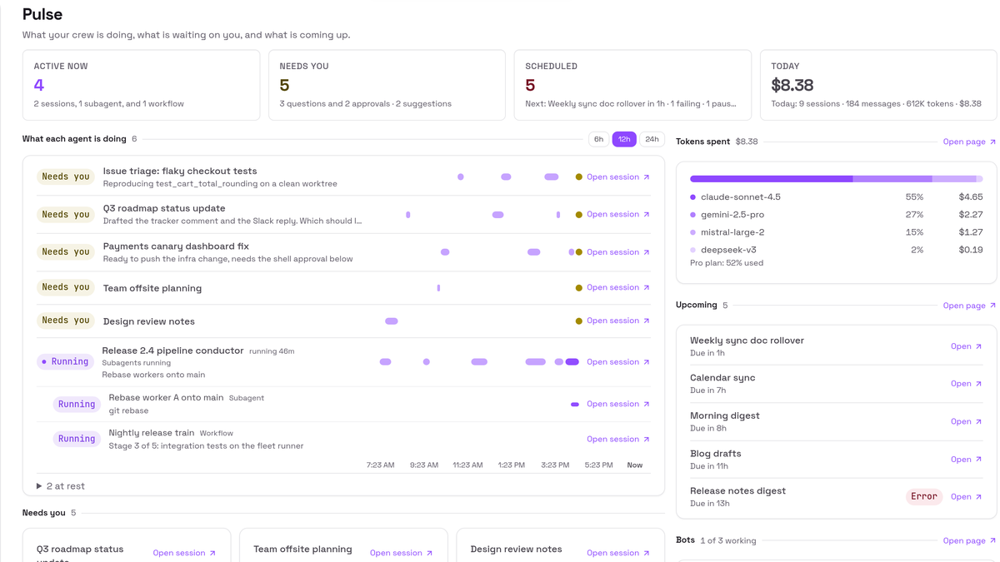

# Pulse

Mission control for your Kiro Crew on one page: which agents are running, what is
waiting on you, what is scheduled next, and what today has cost. Answer question
cards and approve or reject tool calls without opening each session.


https://github.com/user-attachments/assets/17caa40e-5552-43ce-b2a1-d3726f52f036




## What it shows

| Section | What you see | Where it comes from |
|---|---|---|
| Stat strip | **Active now** (sessions, subagents, workflows), **Needs you** (questions, approvals, follow-up offers), **Scheduled** (next job, failing, paused), **Today** (sessions, messages, tokens, spend) | the session list, question and approval inventories, the schedule, the usage report |
| What each agent is doing | one row per session with its subagents and workflows under it, the current step or last words, and a 6, 12 or 24 hour activity track. Sessions wholly at rest fold behind a count | `GET /api/chat/slots`, `/api/spawn`, `/api/workflows/runs`, `/api/usage/turns` |
| Needs you | a card per session that waits on you, six at first, Show all for the rest. A question card answers through the same route the chat uses, an approval card approves or rejects the pending tool call, and a session whose last reply offered next steps shows those as picks beside a box for a reply of your own. Enter sends. An answered card stays in place as a Sent card, showing what went out and the session's live state, until the session asks again or you dismiss it | `/api/ask-question/pending`, `/api/approvals`, the slot rows |
| Tokens spent | today's usage by model as a stacked bar, in dollars on a dollar-billed harness and in tokens otherwise | `GET /api/usage/kiro` |
| Upcoming | the next five jobs due, with a failing or running badge | `GET /api/crons` |
| Bots | the roster, working first, each opening its thread | `GET /api/members` |

Every number is read from the gateway list the dashboard page for it reads, so
Pulse never disagrees with the page it links to. Nothing is sent on a click
alone: a pick stays a draft until **Send answer**, and an approval needs its own
button. A follow-up label that would run as a command if sent bare is withheld,
with a link to answer in the session.

## Install

Clone, then install from the clone. The committed bundle (`ui/dist/index.mjs`)
is what an install loads, so there is no build step.

```bash
git clone https://github.com/ivikash/KiroCrew-Pulse.git ~/KiroCrew-Pulse
kirocrew app install ~/KiroCrew-Pulse
kirocrew app enable crew-pulse
```

`enable` refuses an app that is not built in until you trust it. Enabling from
the dashboard's App Store asks you to trust this app alone. Then open **Pulse**
in the sidebar, or search for it with the command palette.

## Permissions

| Declared | Used for |
|---|---|
| `/api/chat` | sending a follow-up pick or typed reply as the session's next message |
| `/api/chat/slots` | the session list, and a session's own approve route |
| `/api/ask-question` | pending question cards and their answers |
| `/api/approvals` | pending background approvals and their decisions |
| `/api/spawn`, `/api/workflows/runs` | subagents and workflows under each session |
| `/api/crons`, `/api/members` | the schedule and the Bots roster |
| `/api/usage/kiro`, `/api/usage/turns` | today's usage and each session's turn history |
| `/api/status`, `/api/config/kirocrew` | the gateway health line, and whether the harness bills in dollars |
| event `slots` | re-reading the live lists when a session changes |

No storage, no cron, no network, no backend. `tests/manifest.test.ts` holds the
manifest to the paths the code calls, in both directions.

## Develop

```bash
cd ui
npm ci
npm run typecheck
npm test
npm run build          # writes ui/dist/index.mjs, commit it
```

The page is styled with the dashboard's own utility classes. The dashboard
compiles only the classes its own sources use, so a class this bundle uses that
the dashboard does not has no CSS at runtime. `npm run check:classes` looks every
class in the built bundle up in a dashboard build:

```bash
KIROCREW_DIST=/path/to/KiroCrew/website/dist npm run check:classes
```

Run it against the oldest gateway you support as well, by pointing it at that
install's stylesheet (`.../kiro_crew/static/dist/assets/src-*.css`): a class a
newer dashboard uses may be missing from the one your users run.

The few rules the page cannot rely on the host for (the stat strip and page
grids, the board columns and two accent tints) live in `ui/src/styles.ts`, painted from the theme's variables.

For a tight loop against a running dashboard, install from the clone and turn on
dev mode (`kirocrew app dev crew-pulse`): the bundle is served uncached and the
page reloads when `ui/` changes.

## Compatibility

Reads `useAppApi`, `useAppEvents`, `useNavigate`, `useLanguageGeneration` and the
locale formatters from `@kirocrew/app-sdk`, and `Badge`, `Btn`, `Card`,
`EmptyState`, `ErrorNotice`, `PageHeader`, `StatCard` from `@kirocrew/app-sdk/ui`.
All of these ship with Kiro Crew 0.12 and later. Strings are bundled for the
twelve dashboard locales and follow the dashboard's active language.

## License

Apache-2.0. See [LICENSE](LICENSE).
